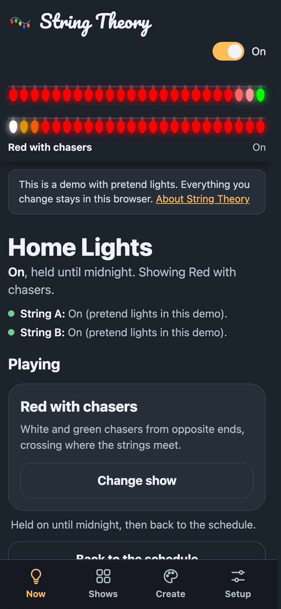
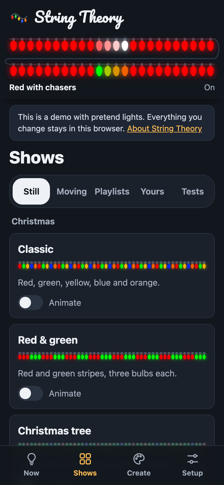
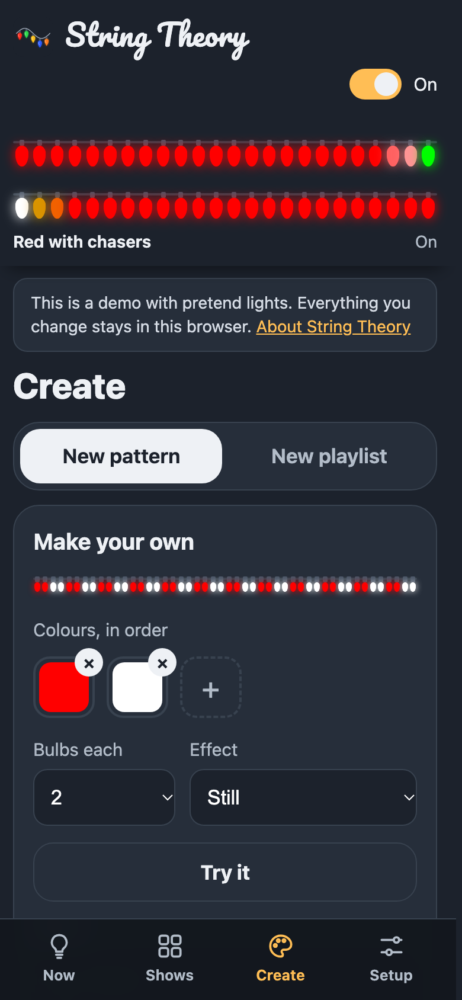
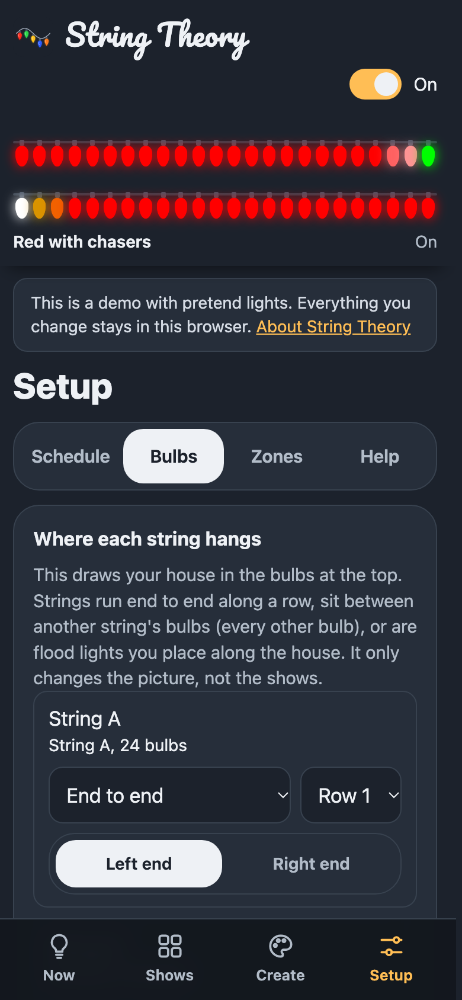

<p align="center"></p>

<h1 align="center">String Theory</h1>

> **No support is provided.** String Theory is shared as-is, as a starting point for your own project: fork it, change it and make it yours. It works on the author's NOMA C9 lights, but there's no help with setup, no fixes on request and no promise it works with your lights or keeps working. Issues and pull requests may go unanswered. See [SUPPORT.md](SUPPORT.md).

Custom light shows for NOMA/Tuya smart light strings (NOMA smart C9 lights and the many other brands built on Tuya), with shows for every season, run from a Raspberry Pi on your home network, with a phone-friendly control page.

Apps like Smart Life, Tuya Smart and NOMA's "Light Show" can only play the effects built into each controller, and they treat every string separately. This project talks to the controllers directly over Wi-Fi and sets every bulb's colour itself, so it can:

- run any number of strings, laid end to end, as **one continuous string**, with chases that flow from one into the next
- play shows the app can't: single-bulb chasers that bounce and cross, colour waves, a rainbow across every string, and playlists you build yourself that switch between themes with chases, fades or quick changes
- switch the lights on and off on a **daily schedule**, optionally fading in and out over a few seconds or minutes, at set times or around sunset and sunrise (worked out on the device from your rough location, with no cloud service involved), for example "5 minutes before sunset, for 6 hours"
- be controlled from a **web page on your phone**: pick a show, turn the lights on or off, change the schedule and adjust the speed. The page previews every show as it really looks, mirrors what the lights are doing right now and warns you if a string stops responding.

It isn't affiliated with Tuya, NOMA or any other brand.

**Website and live demo:** [stringtheory.space.fast](https://stringtheory.space.fast/). The demo is the real app with pretend lights.

<p align="center">
  
  
  
  
</p>

The app has four screens, picked from the bar along the bottom:

- **Now:** what's on, and the everyday controls (power, speed, and Change show).
- **Shows:** everything you can play.
- **Create:** make your own patterns and playlists.
- **Setup:** schedule, zones and help.

The rows of bulbs at the top (one per string) mirror what the strings are showing right now. They stay in view as you scroll on every screen. When the lights are off they show the current show dimmed, with no glow. Every row runs left to right like the real strings, and an S-shaped wire runs from the end of each string back to the start of the next, like wrapped text. Each show's card plays a preview of the show as the lights will show it; playlist cards play sped up (a few seconds per theme) so you can see the whole thing without waiting. Tap **Rename** to give your lights their own name.

## Hardware

- Wi-Fi light strings built on **Tuya**. Many brands sell these under their own names, and they work in the Smart Life or Tuya Smart app. Each bulb (or segment) must be individually colourable: these are often sold as "RGBIC", "colour bar", "dreamcolor" or "paint mode" lights. Any number of strings works.
  - **Tested:** NOMA Smart RGB C9 25 LED Outdoor Christmas Lights (Wi-Fi controller AL901B, 24 colourable bulbs per string, Tuya local protocol 3.5). See [docs/hardware.md](docs/hardware.md) for what works and what doesn't.
  - **Other Tuya strings:** likely to work if they take per-bulb colours the same way. See [Other Tuya lights](#other-tuya-lights) for how to check, and what to change if they don't.
- Something on the same network as the lights to run the show and the control page. Any of these works (see [Choose where it runs](#3-choose-where-it-runs)):
  - **A Raspberry Pi**: the best fit. It's always on and uses very little power. Any model that runs Python 3.11 or newer works, and String Theory needs about 100 MB of RAM, so it can share the Pi with other things.
  - **A computer with Docker**, such as a home server or NAS.
  - **A home computer**, desktop or laptop (Mac, Windows or Linux). The lights only follow the show and schedule while it's on, awake and on your home Wi-Fi.

## How it works

Each controller accepts a "paint" frame over the local network: one colour for each of its bulbs. The engine (`pi/lights.py`) works out what every bulb should look like at the current moment of the show and sends each string its part of the frame.

Things learned along the way:

- **A controller applies at most about one frame every 0.3 s.** Send faster and it drops frames. Shows are designed around steps of 0.4 s or more, so they're built from chases and steps rather than smooth fades.
- **Position comes from the clock**, not from counting frames. Both strings always show the same moment of the show, and a string that misses a frame jumps to the right place instead of falling behind.
- **Latest frame wins.** A string gets a new frame only once it has acknowledged the last one, so a string with weak Wi-Fi skips frames rather than building up a delay.
- **One worker thread per string**, so a string that drops off Wi-Fi can't freeze the other.

Most problems come down to Wi-Fi signal at the controller. The web page shows, for each string, how many changes are getting through.

## Setup

### 1. Get each controller's local key

Local control needs each device's ID, IP address and **local key**, a secret that the controller and Tuya's cloud share. The only way to get it is through a free Tuya developer account. You need this once. After that, everything runs locally and the cloud isn't used.

These steps follow [tinytuya's setup guide](https://github.com/jasonacox/tinytuya#setup-wizard---getting-local-keys), which is kept up to date when Tuya changes its site.

#### a. Move the lights into the Smart Life app

1. In the NOMA app, remove the light strings.
2. Install **Smart Life** ([iPhone](https://apps.apple.com/app/smart-life-smart-living/id1115101477), [Android](https://play.google.com/store/apps/details?id=com.tuya.smartlife)) and sign up with a regular account, not a guest account.
3. Add each string as a new device and give each one a name you'll recognise, such as "C9 Lights" and "C9 Lights 2". Check that you can turn them on and off from Smart Life.

#### b. Create a Tuya developer account and cloud project

1. Sign up at [iot.tuya.com](https://iot.tuya.com). When it asks for an **Account Type**, choose **Skip this step**.
2. Go to **Cloud → Development → Create Cloud Project**:
   - **Project name:** anything.
   - **Industry:** Smart Home.
   - **Development method:** Smart Home.
   - **Data center:** the one that serves your Smart Life account. For North America, that's usually **Western America**. If you choose the wrong one, no devices show up in step c. The data centre that works isn't always the obvious one, so try others until your devices appear.
3. If it offers to subscribe API services during creation, accept the defaults. Skip anything else in the configuration wizard.
4. Open the project's **Overview** and note the **Access ID / Client ID** and **Access Secret / Client Secret**. The setup wizard asks for these.
5. On the **Service API** tab, make sure **IoT Core** and **Authorization** are listed. If they aren't, click **Go to Authorize**, pick them and subscribe. Turn off your browser's pop-up blocker first, because otherwise subscribing fails without telling you.

#### c. Link your Smart Life account to the project

1. In the project, go to **Devices → Link App Account → Add App Account**. Choose **Automatic** and **Read Only Status** (commands still work), then click **OK** to show a QR code.
2. In Smart Life, open the **Me** tab, tap the scan icon in the top corner and scan the QR code.
3. Your lights should now appear in the project's device list. If the list is empty, the data centre is wrong: edit the project to use a different one.

#### d. Fetch the keys

On any computer on the same network as the lights:

```sh
python3 -m venv venv && . venv/bin/activate
pip install tinytuya
python -m tinytuya wizard
```

When the wizard asks, enter:
- the Access ID and Secret from step b
- your region code (for example `us` for Western America)
- `scan` to find a device ID automatically

The wizard writes `devices.json` (each device's name, ID, IP address and local key) and `tinytuya.json` (your cloud credentials). It also writes `tuya-raw.json` and `snapshot.json`. **Keep all of them private.** They are in `.gitignore`.

Notes:
- **Fixed IP addresses:** give each controller a fixed IP address (a DHCP reservation in your router), so the Pi can always find it.
- **Re-pairing:** if you ever re-pair a string in Smart Life, its local key changes. Run the wizard again and copy the new `devices.json` to the Pi.
- **Trial expiry:** Tuya's free IoT Core plan expires after about a month. That doesn't affect the lights, because the show never uses the cloud. It only matters when you need keys again. To extend it, go to **Cloud → Project Management → Extend trial period** (see the tinytuya guide).

### 2. Tell String Theory about your strings

Put `devices.json` in a `data` folder at the top of the project (the scripts below make it for you), then run:

```sh
python3 pi/configure.py
```

It lists your devices and asks which are light strings, in the order they're laid out, and how many bulbs each has. It saves your answers to `data/config.json`. The last bulb of each string should meet the first bulb of the next. Every show stretches to the total length, and each string gets its own worker, so a string with poor Wi-Fi doesn't slow the others.

After you start String Theory, play **Find the seams** on the Tests tab: each string glows in its own colour, its first bulb blinks white and its last is bright. If two strings are the wrong way round, run `configure.py` again and swap them.

### 3. Choose where it runs

All three ways run the same two parts: the **light engine**, which sends each string its colours, and the **control page** on port 8080. Your keys and settings stay in the `data` folder.

#### A Raspberry Pi (recommended)

On the Pi (Raspberry Pi OS Bookworm or later), get the project and run the installer:

```sh
git clone https://github.com/chadworthman/StringTheory.git string-theory && cd string-theory
./scripts/install-pi.sh
```

The installer:
- Sets up Python.
- Offers to run the tinytuya wizard if `data/devices.json` isn't there yet, then runs `configure.py`.
- Installs two services that start at boot: `string-theory` (the engine) and `string-theory-web` (the page).
- Adds a `lights` command (see [Using it](#using-it)).
- Offers to limit the page to your home network if the Pi's firewall is on.

Run it again any time to update or to change strings. Check on it with `systemctl status string-theory`, and read the logs with `journalctl -u string-theory -f`.

Make sure the Pi's timezone is right (`sudo raspi-config` → Localisation, or `sudo timedatectl set-timezone …`), because the schedule uses its local time. For sunset and sunrise times, tap **Locate me** under Setup → Schedule. On the Pi's page, which is plain http, browsers won't share a precise position, so it uses your device's time zone and places you at that zone's main city, which is usually within a few minutes of your real sunset. **Enter exact coordinates** is there for more precision.

#### Docker

On any computer with Docker that stays on (a home server, a NAS, a Linux box):

```sh
git clone https://github.com/chadworthman/StringTheory.git string-theory && cd string-theory
mkdir data   # put devices.json here, or make it with the wizard:
docker compose run --rm -it string-theory sh -c 'cd /data && python -m tinytuya wizard'
docker compose run --rm -it string-theory python configure.py
docker compose up -d
```

Set your timezone in `compose.yaml` (the `TZ` line). Your keys and settings stay in `./data`, never in the image. Use `docker compose logs -f` to watch it and `docker exec string-theory python lights.py status` for the `lights` commands.

The container reaches your lights through the computer's network, so it needs no special settings on Linux. **On a Mac**, Docker runs inside a small virtual machine that macOS blocks from your home network until you allow it: go to **System Settings → Privacy & Security → Local Network** and turn on Docker (or OrbStack). On a Mac, the home computer script below is simpler.

#### A home computer (desktop or laptop)

No Pi or Docker needed, just [Python 3.11 or newer](https://www.python.org/downloads/). From the project folder:

- **Mac or Linux:** `./scripts/run.sh`
- **Windows:** `powershell -ExecutionPolicy Bypass -File scripts\run.ps1`

The script:
- Sets up Python.
- Offers to run the wizard and `configure.py` the first time.
- Starts both parts and prints the address to open on your phone.

Stop it with Ctrl-C, or by closing the window.

The lights only follow the show and the schedule while the script is running, so keep the computer awake and on your home Wi-Fi. When it stops, the lights stay on whatever they last showed. If your phone can't open the page, allow incoming connections for Python in the computer's firewall. On a Mac, also allow Python (or Terminal) under **System Settings → Privacy & Security → Local Network**, so it can reach the lights.

### 4. Open the control page

Browse to `http://<address-of-your-pi-or-computer>:8080` from a phone on your home Wi-Fi, then add it to your home screen: on iPhone, **Share → Add to Home Screen**; on Android, **Install app** in the browser menu. It opens full screen, like an app, with the String Theory icon.

The page has no login. Keep it on your home network: if your firewall is on, allow port 8080 from your LAN only. Don't forward it through your router or publish it through a tunnel without adding authentication.

## Using it

**Shows** has filter chips for **Still**, **Moving**, **Playlists**, **Yours** (patterns you've saved) and **Tests**. Every still theme has an **Animate** switch on its card. Turning it on plays that theme animated, and picking another card turns it off again. Most themes chase their stripes; a few have their own animation (Christmas tree's ornaments twinkle, Sunset flows out from the centre, Aurora colours breathe, Confetti jostles). The Moving chip is for shows that are an animation of their own. Within each, shows are grouped (Christmas, Winter, Holidays in calendar order, Colour, and so on). The app remembers the screen and chip you last used. **Help** (`/help`, on Setup) explains the app and lists every show A to Z, with a Play button for each. You can also control everything from a shell on the Pi:

```sh
lights status                  # current show, power and schedule
lights candycane               # switch show (remembered across restarts)
lights on 2                    # force on for 2 hours, ignoring the schedule
lights off                     # force off for 1 hour
lights auto                    # back to the schedule
lights schedule 16:00 00:00    # daily on and off times
lights schedule sunset-5 6h    # 5 minutes before sunset, for 6 hours (also: sunset sunrise, sunset+10 23:30)
lights location 43.65 -79.38   # your rough location, for sunset and sunrise
journalctl -u string-theory -f # engine log on a Pi, including per-string delivery stats
```

### Shows

| Show | What it does |
|---|---|
| Classic loop | Classic colours, slide to white, candy cane, back to classic. 2 minutes each. |
| Classic | Red, green, yellow, blue and orange. Still. |
| Classic (moving) | Classic colours stepping slowly along. |
| Classic & white | Classic colours stepping along, with an all-white sweep every minute or so. |
| Candy cane (moving) | Red, white and green candy-cane stripes on the move. |
| Meet in the middle | Red, green and white stripes flowing toward the join. |
| Red with chasers | White and green chasers from opposite ends, crossing where the strings meet. |
| White with chasers | The same, with red and green chasers on white. |
| Icy | Bands of deep blue, ice blue and white drifting along. |
| Confetti (moving) | The rainbow colours in random spots, jostling and drifting along. |
| Halloween (moving) | Orange, purple and dark green stripes on the move. |
| Embers | Glowing coals in deep red and amber, flickering like a fire. |
| Snowfall | White flakes drifting along a night-blue string, piling up at the end. |
| Theatre marquee | Every third bulb lit, stepping along like an old cinema sign. |
| New Year's Eve | Gold and white all evening, then a minute of rapid flashes at midnight. Set the schedule's off time past midnight that night. |
| Hanukkah | A blue and white menorah: the shamash at the join, four candles on each side. During Hanukkah it lights one more candle each night. |
| Fourth of July fireworks | Red, white and blue fireworks bursting and fading over a night-blue sky. |
| Easter (moving) | Pastel pink, yellow, mint, blue and lilac stripes chasing along. |
| St. Patrick's Day (moving) | Bright green, dark green and gold stepping along. |
| Sunrise & sunset | From a deep night blue, the colour rises from the centre out through blue, purple, red, orange and yellow until the centre glows white, holds for the day, then sets back to night blue the same way. |
| Sunset (moving) | Red, orange, amber, pink and purple stripes moving out from the centre, round and round. |
| Twinkling Christmas tree | Steady green with red, gold and blue ornaments that twinkle, each on its own rhythm. |
| Aurora colours (moving) | The aurora bands holding still while the blue slowly widens and narrows around each purple centre. |
| Rainbow (moving), Double rainbow (moving) | The colour wheel (once or twice end to end) rolling along. |
| Fibonacci | On a white string, golden-angle colours grow from the start 1, 2, 3, 5, 8, 13, 21, 34 bulbs until it is full, then give way to white from the start the same way, so the colour travels along. |
| Slava Ukraini | Ukraine's blue and yellow, three ways in turn: stripes chasing along, the flag waving, then sunflowers opening on a blue sky. |
| Chaos | Colours changing at random, the whole string lurching about, sudden white bursts, strobes, and stretches of bulbs going dark. |
| Holiday autopilot | Picks a show by date: Valentine's Day, St. Patrick's Day, Easter, Canada Day, Fourth of July, Halloween, Hanukkah, Christmas, New Year's Eve, and Classic the rest of the year. |

Still themes: Classic, Holly (three green leaves and a red berry), Candy cane, Rainbow, Double rainbow ([what does it mean?](https://www.youtube.com/watch?v=OQSNhk5ICTI)), Confetti, Golden angle (each bulb 137.5° round the colour wheel from the last, like sunflower seeds), Halloween, Red & green, Christmas tree, Peppermint, Blue & white, Silver & gold, Aurora colours, Sunset, Valentine's Day, St. Patrick's Day, Easter, Canada Day and Fourth of July.

Hockey: all 32 NHL teams have their own tab, each in a pattern based on its jersey (black is an unlit bulb). String Theory isn't affiliated with the NHL or any team.

**Follow a team.** Your regular show, picked from any other tab, plays as usual. On the Hockey tab, tap a team to follow it (the card shows **Following**; tap again to stop). During every one of its games, from 15 minutes before puck drop until the final horn, the lights switch to the team's stripes chasing along; with **Turn the lights on for games** (on by default) they come on even outside your schedule. Each goal plays a celebration: a red goal light sweeping back and forth, then the team's colours flashing, about 10 seconds in all. After the game the lights go back to your regular show. Pick another show mid-game to take the lights back until the next game. The Hockey tab also has a **Goal delay**, to line the celebration up with your TV (broadcasts and streams usually run 10 to 60 seconds behind live), and **Test celebration**. **Play now** on a card makes that team your regular show.

This is the only part of String Theory that uses the internet, and only while you follow a team. It reads the NHL's public live-score service (`api-web.nhle.com`, the one the NHL's own website uses), which needs no account: the team's schedule a few times a day, the game every 30 seconds from 15 minutes before puck drop, and every 5 seconds while it's live. That service isn't an official, documented API, so it could change without notice.

Test patterns, for setting up and for chasing down Wi-Fi problems:

| Test | What it's for |
|---|---|
| Find the seams | Each string glows dimly in its own colour. Its first bulb blinks white and its last bulb is bright, so a bright bulb next to a blinking white one marks a seam. It also shows which way each string runs. |
| Bulb walk | One red bulb steps along every bulb. If it ever skips a bulb, an update was dropped, usually because of weak Wi-Fi at that string. |
| Which string is which | Each string its own colour (red, green, blue, yellow, purple, white). Use it to check the order you gave `configure.py`. |
| All white | Every bulb at full white, to spot dead or dim bulbs. |
| Test pattern | Colour bars like an old TV test card (white, yellow, cyan, green, magenta, red, blue), with the reversed band on the next string. Shows every pure colour side by side. |

Each moving show has a speed setting on the web page. Its top speed is capped where the strings would start skipping. A **Brightness** slider, from 10% to 100%, dims every show in a zone: String Theory scales each bulb's colour itself, since the controllers' own brightness setting doesn't respond.

### Custom shows and the controllers' built-in effects

**Create** lets you build a show without touching code:
1. Pick up to 8 colours.
2. Choose how many bulbs each colour covers.
3. Choose an effect.
4. Tap **Try it** to see it on the lights, then give it a name and save it. Saved patterns appear under **Yours** on Shows, where you can edit or delete them.

The effects come in two groups:
- **Run by the Pi:** Still, Chase along, and Flow toward the join. These run across all the strings as one, like the other shows.
- **Built into the controllers:** the effects in the NOMA and Smart Life apps. The controller runs these itself, so its fades are smooth, which the Pi can't match at about 3 updates a second. Each string runs the effect on its own clock, though, so the two can drift apart a little.

The apps don't show clearly what each built-in effect does, and the controller only knows them by number. The editor lists them as Effect 0 to 31. Try each one, then type what it looks like into the box. The name is saved, and from then on it appears in the list.

### Zones

A **zone** is a group of strings with its own name, show, speed, power and schedule. For example, the porch can play Candy cane while the garage plays Icy, each on its own timetable. Set them up under **Zones** on the Setup screen:
- Add a zone.
- Pick each string's zone.
- Rename or delete zones.

When there's more than one zone, buttons under the logo switch between them. Each zone's shows span just its own strings, so a rainbow fills the whole zone. Saved patterns and playlists work in every zone.

From a shell, `lights --zone Garage icy` (or `on`, `off`, `auto`, `schedule`) acts on a named zone. Without `--zone` it acts on the first zone.

### Playlists

**Playlists** on the Shows screen has these built-in playlists, plus any you save:

| Playlist | Steps |
|---|---|
| Classic loop | Classic, All white and Candy cane, 2 min each, chasing in |
| Christmas medley | Classic (moving), Candy cane (moving), Christmas tree, Snowfall and Red with chasers, 5 min each |
| Winter night | Icy, Snowfall and Aurora colours (moving), 5 min each, then Blue & white, fading between them |
| Fireside | Embers 10 min, then Classic 5 min, fading |
| Spooky night | Halloween (moving), Embers, a burst of Chaos, then Halloween |
| Rainbow tour | Rainbow (moving), Double rainbow (moving), Confetti (moving), Golden angle and Fibonacci |
| Party | Chaos, Rainbow (moving), Theatre marquee, Confetti (moving) and Double rainbow (moving), 30 s each, quick changes |

Names follow one rule: when a theme comes both still and moving, the still one has the plain name and the moving one adds "(moving)".

**Edit a copy** under any of these opens it in the playlist builder, so you can make your own version.

**New playlist** on Create (or **Build your own playlist** under Playlists) makes a show that switches between themes:
1. Pick a theme and how long it shows, from 15 seconds to 30 minutes.
2. Pick how it changes to the next theme:
   - **Chase in:** the next theme pushes in from the first bulb, one bulb at a time.
   - **Fade:** a 4-second crossfade.
   - **Quick change:** an instant switch.
3. Add as many themes as you like, up to 20. After the last, the playlist goes back to the first.

Themes can be any still or moving show, or a pattern you've saved, as long as it doesn't use a built-in effect. Moving themes keep moving through their time and during transitions.

### Other Tuya lights

**Step-by-step guide:** [docs/adapting.md](docs/adapting.md) walks through finding your controller's data points with `tools/probe.py`, testing the per-bulb format on your lights, and what to change (or what to ask an AI coding assistant to change) if it differs.

Tuya controllers describe everything as numbered **data points (DPs)**: one for on/off, one for per-bulb colours, one for built-in effects, and so on. The engine uses the NOMA C9 numbers. To use different ones, add them to `data/config.json`:

```python
"dp_switch": 20,      on/off
"dp_paint": 102,      per-bulb colours
"dp_effect": 104      the controller's built-in effects
```

To check another set of lights:

1. Get its key with the wizard (step 1 of Setup) and add it with `configure.py`.
2. Run `python tools/sniff.py devices.json` on a computer on the same network. While it runs, use the paint or DIY mode in Smart Life to colour a few bulbs. It prints every DP that changes.
3. If paint mode shows up as DP 102 in the form `00 00 00 01 01` followed by 5 bytes per bulb (`R G B 00 00`), it's the same as NOMA's and should just work.
4. If paint mode uses a different DP number, set `dp_paint` in `data/config.json` (and likewise `dp_switch` and `dp_effect`).
5. If the layout of the bytes is different, `frame()` in `lights.py` builds them, and that's the one function to adapt.
6. Run the **Find the seams** and **Bulb walk** tests to confirm every bulb is where the engine thinks it is.

Built-in effects (in Create) are the most brand-specific part. If yours behave differently, everything else still works without them.

If you get another brand working, you're welcome to share its model and DP numbers in a pull request or your own fork's README, so others can find them. Pull requests may not be reviewed (see [SUPPORT.md](SUPPORT.md)).

### Adding a show

A show is a function from time in seconds to a list of `TOTAL` `(r, g, b)` colours, one per bulb across all strings. Add it to `SHOWS` in `pi/lights.py`, using the builders there (`chase`, `converge`, `scanner`, `playlist`, …), and give it a friendly name in `SHOW_INFO` in `pi/web.py`. A show goes on the Moving or Still tab depending on whether it has a `period`. To put it on the Tests tab instead, add it to `TESTS` in `web.py`.

If it moves, the function needs a `period` (seconds before it repeats) and a `step` (shortest time between changes). The builders set these for you. Without them the page can't animate the preview or offer a speed setting.

Colour notes for these LEDs:
- Use pure white `(255, 255, 255)`. Warm whites look pink or peach next to red.
- Stripes three bulbs wide make the clearest chases.
- `(255, 60, 0)` looks red, and yellow needs a lot of green: `(255, 180, 0)`.

## Files

| Path | What it is |
|---|---|
| `pi/lights.py` | Show engine, schedule and `lights` command |
| `pi/web.py`, `pi/index.html` | Control page (Python standard library only) |
| `tools/probe.py` | Finds out how your controller works: lists DPs, watches the app, tests painting (see docs/adapting.md) |
| `pi/configure.py` | Picks your strings and their order; writes `data/config.json` |
| `scripts/install-pi.sh` | Installs String Theory on a Raspberry Pi as two services |
| `scripts/run.sh`, `scripts/run.ps1` | Runs it on a Mac, Linux or Windows computer |
| `Dockerfile`, `compose.yaml`, `docker/start.sh` | Runs it in Docker |
| `pi/*.service`, `pi/lights` | Older hand-written service files (the installer writes its own) |
| `site/`, `tools/build_site.py` | The website. `python3 tools/build_site.py` builds `site/dist` (the home page, plus the real app with `site/src/demo.js` as a pretend Pi) and `sf publish site/dist` publishes it to Spacefast |
| `docs/` | Screenshots for this README, and plans: `plan-layout.md` (vertical strings) and `plan-import.md` (build shows online and import them) |
| `pi/fonts/` | Pacifico, the title font, by the Pacifico Project Authors, under the SIL Open Font License (`Pacifico-OFL.txt`) |
| `tools/` | One-off experiments used to work out the protocol and speed limits (`sniff.py` logs what the official app sends, `speed_test.py` and `lag_test.py` measure delivery) |
| `data/` | Your files: `devices.json` and `tinytuya.json` (keys and credentials from the wizard), `config.json` (your strings) and the settings String Theory saves. Never commit or share them. |
| `state.json`, `engine.json`, `health.json` | Runtime files the Pi writes |

## License

MIT. See [LICENSE](LICENSE). The bundled Pacifico font is under the SIL Open Font License 1.1 (`pi/fonts/Pacifico-OFL.txt`).
